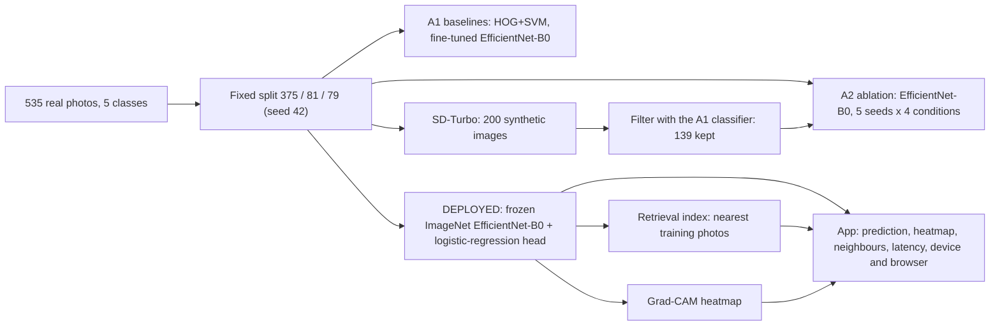
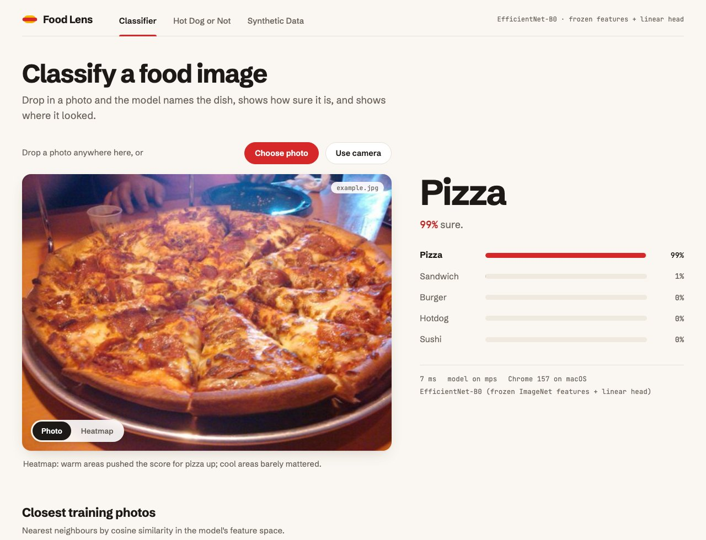
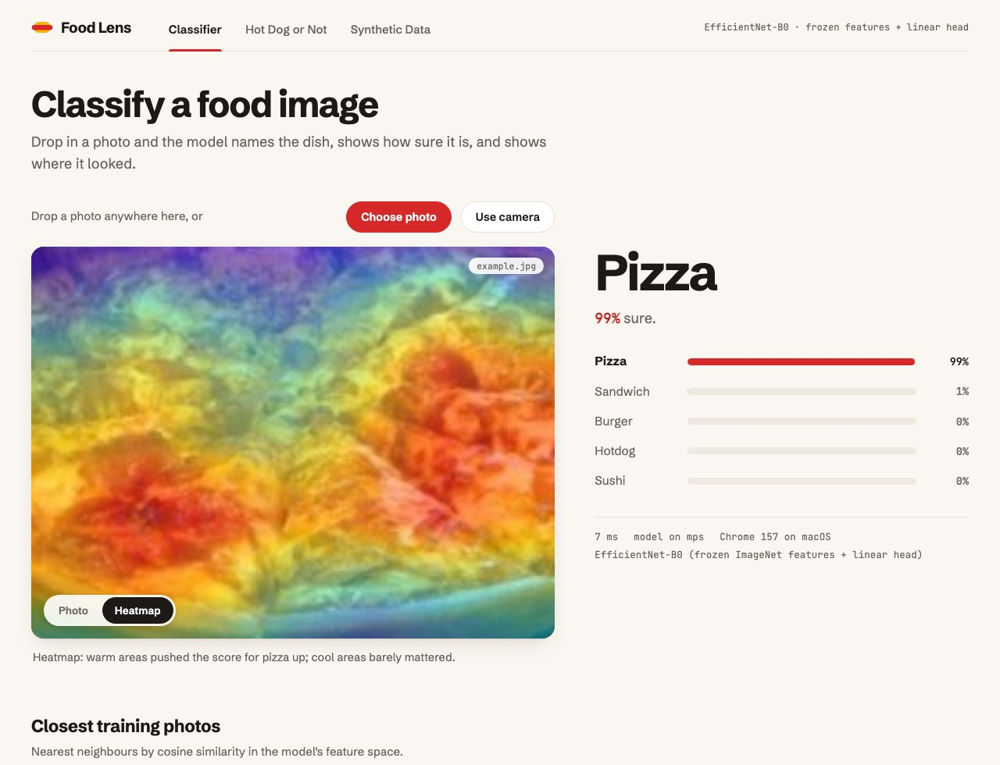
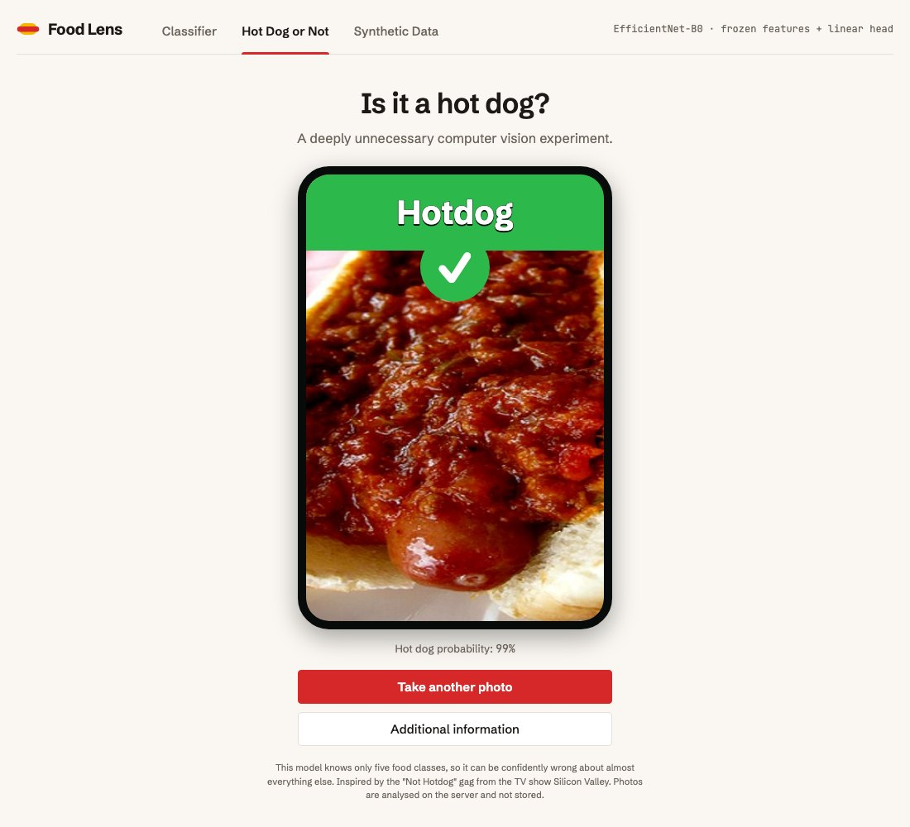
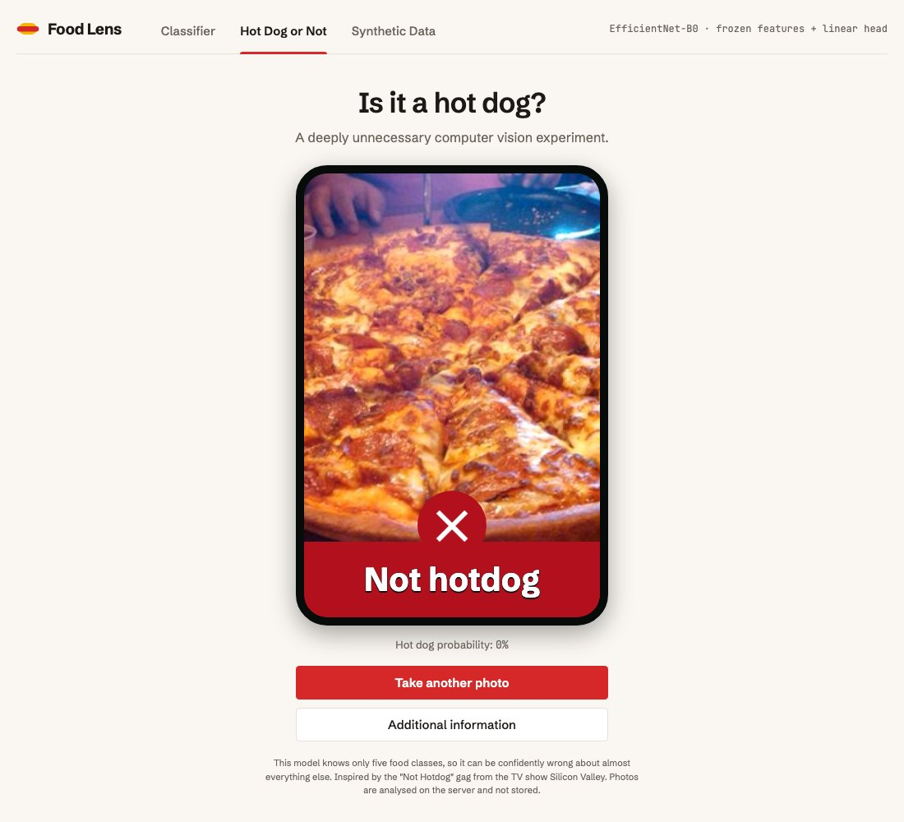
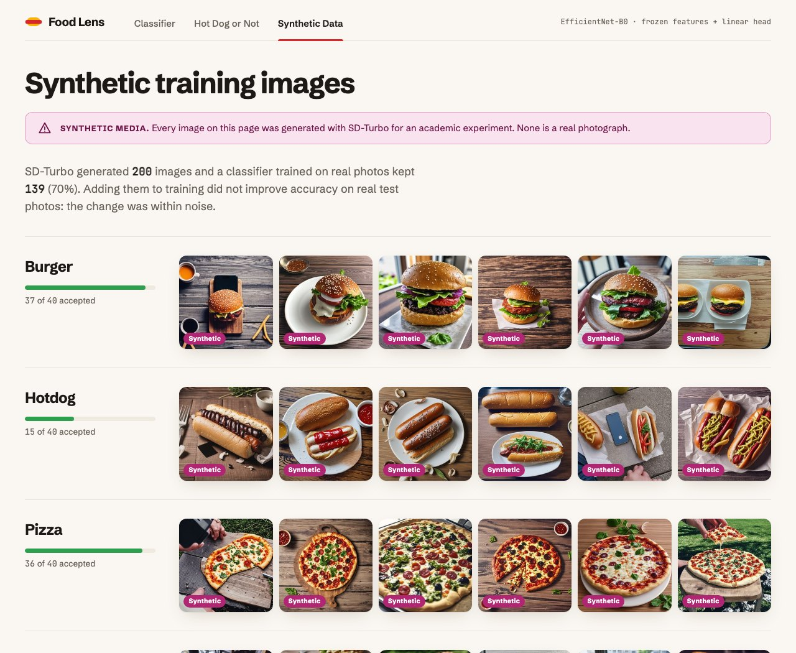
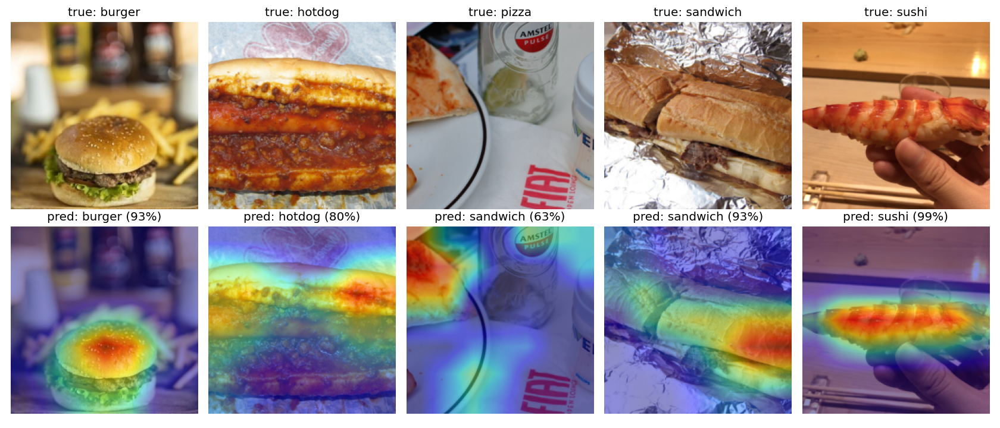
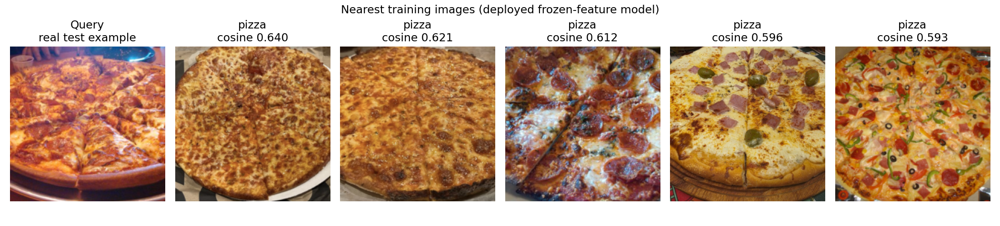
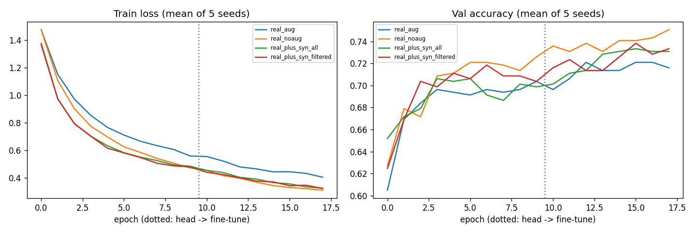

# Food classification, Assignment 2: synthetic data, retrieval, explainability, demo app

Classes: burger, hotdog, pizza, sandwich, sushi (A1 dataset, 535 real images; split 375/81/79).

## Pipeline



How it works: a photo is resized and centre-cropped to 224 x 224, an ImageNet-pretrained EfficientNet-B0 turns it into a
1280-number feature vector, and a small logistic-regression layer turns that into five class probabilities. The same
features rank the real training photos by cosine similarity (nearest neighbours). Grad-CAM weights the last convolutional
feature maps by their gradient for the predicted class to produce the heatmap. Synthetic images are used for training
experiments only; validation and test sets are always real photos.

## Layout

```
a1/          A1 scripts (dataset check, split, preprocessing, SVM, EfficientNet, error analysis),
             notebook and report. Run from the repo root, e.g. python3 a1/split_dataset.py
src/         A2 code: train, generate_synthetic, filter_synthetic, retrieval, explain,
             aggregate, make_figures, hotdog_eval, build_app_assets, common
app/         Streamlit frontend (this is what Streamlit Cloud runs: main file app/app.py)
server/      FastAPI app: /api/predict, /api/explain, /api/synthetic + serves web/
web/         Frontend, plain HTML/CSS/JS (no build step): index.html (Hot Dog or Not),
             classifier.html, synthetic.html, css/ (style.css base + lens.css, also used by the Streamlit app),
             js/, assets/ (thumbnails, synthetic samples)
scripts/     run_baselines.sh, run_ablation.sh
docs/        NOTES.md (numbers and caveats for the report), DEPLOY.md
results/a1/  A1 outputs, incl. the checkpoint efficientnet_best.pt
results/a2/  A2 outputs: per-seed runs, comparative summary, model/index, metrics and figures
Dockerfile   container for the FastAPI version (CPU PyTorch, port 7860)
dataset/, dataset_split/, synthetic/   images, git-ignored
```

All commands are run from the repo root.

A1 (HOG+SVM baseline and EfficientNet-B0) lives in `a1/`. A2 adds:

| Component | File |
|---|---|
| Parameterised training (seeds, augmentation switch, optional synthetic train data) | `src/train.py` |
| Synthetic image generation (SD-Turbo text-to-image, hard-case prompts) | `src/generate_synthetic.py` |
| Classifier-based filtering of synthetic images | `src/filter_synthetic.py` |
| Linear probe on frozen ImageNet features (the deployed model) | `src/train_linear_probe.py` |
| Retrieval index + precision@k | `src/retrieval.py` |
| Grad-CAM (pure PyTorch) | `src/explain.py` |
| Web app "Food Lens" (FastAPI API + plain HTML/CSS/JS frontend): "Hot Dog or Not" (joke, opens on the camera, home page), the real classifier (Grad-CAM, nearest neighbours, latency) and a synthetic-images page | `app/` (Streamlit) or `server/` + `web/` (FastAPI + HTML) |
| Hotdog-vs-rest check for the joke service (precision/recall at the 0.5 rule) | `src/hotdog_eval.py` |
| Tables (mean ± std over seeds) | `src/aggregate.py` -> `results/a2/summary.md` |

## Run

```bash
python3 -m pip install -r requirements.txt   # Python 3.9+, Apple MPS / CUDA / CPU
# put the 535 images in dataset/<class>/ (Drive link in the A1 report), then:
python3 a1/split_dataset.py                       # seed 42 -> 375/81/79
./scripts/run_baselines.sh                             # real-only, 5 seeds, aug / no-aug
python3 src/generate_synthetic.py --per-class 40   # downloads SD-Turbo (~2 GB)
python3 src/filter_synthetic.py --thr 0.5
./scripts/run_ablation.sh                              # real + synthetic, 5 seeds
python3 src/train_linear_probe.py                  # deployed model + metrics vs the A1 fine-tuned one
python3 src/retrieval.py                           # P@k + results/a2/index.npz
python3 src/aggregate.py                           # comparative and ablation tables
python3 src/make_figures.py                        # Grad-CAM, curves, nearest-neighbour figure
streamlit run app/app.py                 # Streamlit version, or:
uvicorn server.main:app --port 8000      # FastAPI + HTML version, then open http://localhost:8000
```

## Dataset

535 real photos in five classes (burger 112, hotdog 98, pizza 103, sandwich 117, sushi 105), collected and cleaned in
Assignment 1 (34 wrong or duplicate images were removed; this cleaning is described in the A1 report). Some photos come from
the web, so the dataset is **not** redistributed in this repository.

- Download: <https://drive.google.com/drive/folders/1D6uadjrY0yAQLyzzfscEyOCIu9pm_0kU?usp=sharing>
- Google Drive refuses to list more than 50 files of a folder to scripts, so download the whole folder in the browser
  (Drive packs it into a `.zip`), put the zip in the repository root, and run `python3 a1/prepare_dataset.py`.
  It unpacks the images into `dataset/` (if the zip has an extra top-level folder, move the five class folders directly under `dataset/`), validates them (corrupt files, duplicates, sizes) and writes
  `results/a1/dataset_report.txt`. Then `python3 a1/split_dataset.py` recreates the split (375 / 81 / 79, seed 42).
- Running the app does **not** need the dataset: thumbnails of the training photos used by the nearest-neighbour view
  are in `web/assets/train/`.

## Model weights

| Weights | Where they come from |
|---|---|
| `results/a2/linear_probe.pt` (16 MB): the deployed model | checked into this repository; rebuilt by `src/train_linear_probe.py` |
| `results/a1/efficientnet_best.pt` (16 MB): A1 fine-tuned baseline | checked into this repository |
| ImageNet EfficientNet-B0 backbone | downloaded automatically by torchvision on first use (`IMAGENET1K_V1`) |
| SD-Turbo (only for regenerating synthetic images) | downloaded from Hugging Face by `src/generate_synthetic.py` (about 2 GB) |

## Final report, results, and inference files

- [Assignment 2 report](results/a2/report.md) presents the dataset, method, results, ablations,
  visualizations, limitations, and ethics disclosures.
- [Comparative metrics and ablations](results/a2/summary.md) is regenerated by
  `python3 src/aggregate.py`; it includes the A1 baselines, the A2 frozen-feature probe, repeated-seed
  CNN ablations, retrieval P@k, and synthetic acceptance counts.
- `results/a1/efficientnet_best.pt` is the A1 fine-tuned EfficientNet-B0 checkpoint (79.7% on the
  79-image test split). `results/a2/linear_probe.pt` is the deployed frozen-ImageNet EfficientNet-B0
  plus logistic-regression head. These are different models; the app uses the latter.
- The app also requires `results/a2/index.npz` (real-training-image retrieval index),
  `results/a2/synthetic_filter.json`, `web/assets/train/`, and `web/assets/synthetic/`.
  The input dataset, split, and generated SD-Turbo images are local/ignored; inference artifacts
  and UI thumbnails are checked into the repository.

The linear-probe checkpoint is trained by `src/train_linear_probe.py`; the retrieval index is built
from its frozen 1280-dimensional features by `src/retrieval.py`. The A2 report distinguishes its
single-fit probe results from the five-seed EfficientNet ablation. The highest repeated-seed CNN
accuracy was the real-only, no-augmentation condition (83.8% ± 1.2%); synthetic additions did not
produce a measurable gain. The app's deployed probe reached 88.6% on the same small test set after
refitting on train + validation. See [docs/NOTES.md](docs/NOTES.md) for historical caveats and
interpretation.

### Demo walkthrough (3–5 minutes)

Use the local app at `http://localhost:8000` or the deployed Streamlit app. Grant camera access only
if you intend to demonstrate it; otherwise use `web/assets/example.jpg` as the upload. A concise
walkthrough:

1. **0:00–0:30** Introduce the five classes and the app; say whether the input is a real test photo
   or a live camera photo.
2. **0:30–1:30** Upload/capture an image, show the top prediction, class probabilities, and the
   displayed inference latency/device. State that latency is model-forward time, not total page time.
3. **1:30–2:30** Switch between Photo and Heatmap, then point out the five nearest real training
   photos and their cosine similarities.
4. **2:30–3:30** Open Synthetic Data; explain SD-Turbo provenance, generated/accepted counts, and
   that adding synthetic data did not improve test performance.
5. **3:30–4:30** Close with the closed-set limitation (five food classes only), web-photo
   consent/licensing caveat, and a brief reproduction pointer to this README.

For the browser camera, serve over HTTPS or `localhost`. A real-device camera walkthrough and
re-recording of a final video remain presenter-side checks; the checked-in project does not include
a recorded demo.

`results/a1/efficientnet_best.pt` and the app's required inference artifacts above are relative to the
repository root. To reproduce model training from scratch, supply the 535 source photos under
`dataset/<class>/`; the files in `dataset/`, `dataset_split/`, and `synthetic/` are not tracked.
The camera needs HTTPS or `localhost`. Deployment (Streamlit Cloud, other hosts): `docs/DEPLOY.md`.

## Examples

Input photo and what the app returns for it (`web/assets/example.jpg` is a real test-set pizza photo):

| Prediction, ranking, latency, device and browser | Same photo, Heatmap view (Grad-CAM) |
|---|---|
|  |  |

| Hot Dog or Not: hot dog | Hot Dog or Not: not a hot dog |
|---|---|
|  |  |



Grad-CAM examples (one real test photo per class; the pizza photo is misclassified as sandwich, a useful failure case) and nearest-neighbour retrieval:




Training curves (mean over five seeds, per training condition):



## Tests

```bash
python3 -m pip install -r requirements-dev.txt
python3 -m pytest -q          # 31 tests, a few seconds, no dataset or GPU needed
```

They cover preprocessing and EXIF orientation, the deployed model and Grad-CAM, retrieval-index consistency, the API
(contract, error handling, rotated uploads, synthetic counts), the browser/OS label, and that the numbers in
`results/a2/summary.md` match the saved per-seed run files. GitHub Actions runs them on every push.

## Synthetic media and ethics

- All images in `synthetic/` were generated by SD-Turbo (`stabilityai/sd-turbo`) and are used
  for **training only**; validation and test sets contain real photos only. `synthetic/metadata.csv`
  records every prompt and seed. The app labels them "SYNTHETIC" in the interface.
- The assigned methods (TA-TiTok + MaskGen, ArtAug) were not available as runnable public
  weights for this project; SD-Turbo is a substitute with the same role (tail/hard-case data
  synthesis). See the report.
- Some real images come from the web (see the A1 report, section 2.3). At least one training photo shows an
  identifiable person (it can appear in the nearest-neighbour gallery); review the photos before publishing.
- "Hot Dog or Not" is a joke service inspired by the Silicon Valley TV show gag. It reuses the
  5-class model and is unreliable for out-of-distribution inputs (shoes, bananas...).
- Uploaded photos are sent to the server for inference, processed in memory and not stored.
