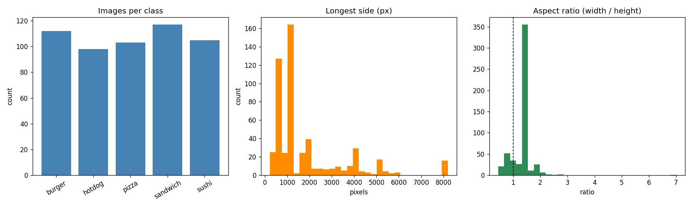
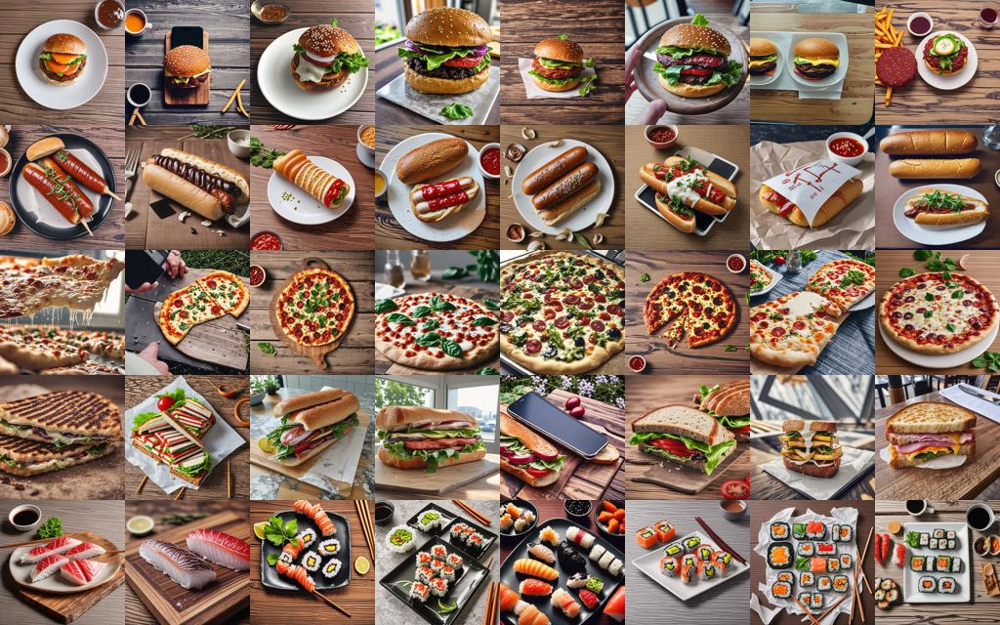
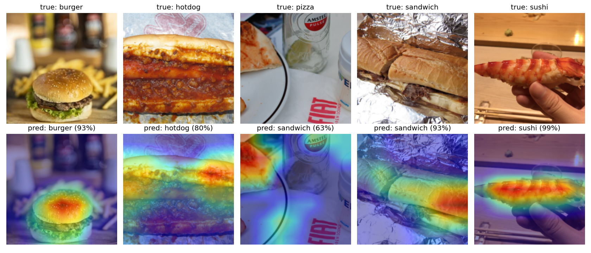
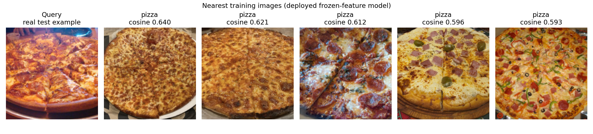

# Food Classification with Synthetic Data, Retrieval, and Explainability

**Assignment 2 report · Food Lens**

**Classes:** burger, hotdog, pizza, sandwich, sushi

**Evaluation:** fixed real-image test set, 79 images

## Abstract

This project extends a five-class food image classifier with synthetic training images, nearest-neighbour
retrieval, Grad-CAM explanations, and a browser-based demo. The source dataset contains 535 real photos.
The evaluation protocol keeps validation and test images real, and adds generated images only to training.
We generated 200 SD-Turbo images, retained 139 with an A1-classifier filter, and compared four EfficientNet-B0
training conditions across five seeds. The best repeated-seed result was **83.8% ± 1.2% test accuracy**
without training augmentation. Adding all synthetic images to the augmented real-data condition produced
80.8% ± 1.7%; filtering produced 78.5% ± 3.5%. These experiments do not show a reliable benefit from
synthetic augmentation. A separate frozen-ImageNet-feature logistic-regression probe scored 89.9% in its
train-only fit and 88.6% after refitting on train plus validation for deployment. These are single-fit
measurements, not directly comparable repeated-seed estimates. Retrieval reached P@1 = 0.873 with the
deployed probe. The report concludes that the data size, class overlap, and evaluation-set uncertainty are
more important limitations than the choice of synthetic filter.

## 1. Dataset and evaluation protocol

The dataset has 535 valid images across five food classes. The original class counts are reasonably close,
but not identical: burger 112, hotdog 98, pizza 103, sandwich 117, and sushi 105. The largest class is
1.19 times the smallest. A scan found no corrupt files, exact duplicates, or visually similar pairs at the
chosen perceptual-hash distance threshold. Images vary widely in resolution and aspect ratio; some are
small, while a few are several thousand pixels wide. This diversity is useful but also means that center
cropping can remove context or part of a dish.



The fixed, seeded split contains **375 training, 81 validation, and 79 test images**. It is generated
class-by-class with seed 42 and an approximate 70/15/15 ratio. The held-out validation and test sets contain
real photos only; the same 79 real test examples are used throughout the A2 experiments. Each image is
resized and center-cropped to 224 × 224 for evaluation, converted to RGB, and normalized with ImageNet
statistics. The augmented training condition uses random resized crops, horizontal flips, rotations up to
15 degrees, and color jitter.

The modest class imbalance is not the main source of uncertainty. With only 79 test examples, a single
correct/incorrect prediction changes accuracy by about **1.27 percentage points**. The reported standard
deviations across five seeds measure variation from training randomness; they are not confidence intervals
for the population performance. Differences of a few points should therefore be treated cautiously.

## 2. Models and synthetic-data integration

### Baselines and fine-tuned CNN

The A1 baseline is an RBF-kernel SVM trained on HOG image features. Its test accuracy was 53.2% and its
macro-F1 was 50.2%. A1 also fine-tuned an ImageNet-pretrained EfficientNet-B0, achieving 79.7% accuracy
and 80.1% macro-F1 on the test split.

For the A2 repeated-seed experiments, `src/train.py` uses EfficientNet-B0 and the same two-stage recipe
for each seed: train the classifier head for 10 epochs at learning rate 1e-3, then fine-tune the network
for 8 epochs at 1e-5. The checkpoint with the best validation accuracy is evaluated on the fixed test set.
Five seeds are run for each condition. This is the repeated-seed comparison used for the synthetic-data
ablation; do not confuse it with the separately fitted deployed linear probe below.

### SD-Turbo generation and filtering

The assigned TA-TiTok/MaskGen and ArtAug methods were not run in this repository. No claim is made that
the results reproduce those methods. Instead, SD-Turbo (`stabilityai/sd-turbo`) was used as a practical,
explicitly identified text-to-image substitute for training-set enrichment. The generator creates 40
512 × 512 images per class (200 total) in two denoising steps. Prompts combine a class-specific dish
description with a viewing angle, setting, and “amateur smartphone food photo” style phrase. Prompt text
and per-image seeds are written to `synthetic/metadata.csv`.

All generated images are added to the **training set only**. They do not replace real validation or test
photos. A filter then applies the A1 fine-tuned classifier: an image is accepted only when the predicted
class matches the intended prompt class and its confidence is at least 0.5. It accepted 139 of 200 images:
burger 37/40, hotdog 15/40, pizza 36/40, sandwich 15/40, and sushi 36/40. Hotdog and sandwich were
frequently rejected as sushi, demonstrating that the filter reproduces the classifier’s own class
confusions rather than providing independent human validation.



### Frozen-feature probe and retrieval

The deployed classifier is a separate model: an ImageNet-pretrained EfficientNet-B0 backbone is frozen,
its 1280-dimensional pooled features are extracted, and a logistic-regression head is fitted. The regularizer
`C` is selected using validation accuracy (chosen value 0.1). A training-only probe is evaluated for the
cleanest comparison. For deployment, a probe is refit on train plus validation, then exported into the
EfficientNet classifier layer so existing inference, Grad-CAM, and retrieval code can use it. The model
export check found a maximum probability difference of about 2.1e-8 between the scikit-learn head and the
exported PyTorch model.

Retrieval uses L2-normalized 1280-dimensional EfficientNet features. The index contains real training
images only; each real test image is a query; a retrieved image is relevant when its class matches the
query class. Cosine similarity ranks the nearest examples. The app displays the top five images with class
labels and similarity scores.

### Explainability and application

Grad-CAM is computed from the final convolutional block of the deployed EfficientNet-B0. It produces a
class-specific heatmap over the model’s 224 × 224 input crop. This is a visualization of activation
gradients, not proof that the model reasons correctly or causally.

Food Lens supports image upload and a browser camera input, displays class probabilities, offers a
Photo/Heatmap switch, shows five nearest real training images, and reports device and inference latency.
It also has a clearly labelled synthetic-images page. The current app checkpoint is the frozen-feature
probe (`results/a2/linear_probe.pt`), not the A1 fine-tuned checkpoint. The local FastAPI smoke test returned a **7.6 ms** warm forward-pass mean on Apple MPS (10 runs);
subsequent browser runs displayed 9–16 ms. These measurements vary and cover the model forward pass
only—not upload, preprocessing, Grad-CAM, retrieval, network, or page-render time—so they should not
be presented as a typical end-to-end figure.

## 3. Results

### Baseline-to-probe comparison

| Model / condition | Test accuracy | Test macro-F1 | Evaluation |
|---|---:|---:|---|
| A1 HOG + RBF-SVM | 53.2% | 50.2% | Single fit |
| A1 fine-tuned EfficientNet-B0 | 79.7% | 80.1% | Single fit |
| A2 EfficientNet-B0, real + augmentation | 80.0% ± 0.9% | 80.6% ± 0.8% | Five seeds |
| A2 EfficientNet-B0, real, no augmentation | **83.8% ± 1.2%** | **84.3% ± 1.2%** | Five seeds |
| A2 frozen probe, train-only fit | 89.9% | 90.2% | Single fit |
| A2 deployed frozen probe, train + validation fit | 88.6% | 89.2% | Single fit |

The probe results are not a like-for-like repeated-seed comparison with the fine-tuned CNN rows: they use
frozen pretrained features, a different fitting procedure, and one fit per condition. In particular, adding
validation examples for the deployed probe does not guarantee a higher score on this small fixed test set.
The table is descriptive, not evidence that the frozen probe is statistically superior.

### Synthetic-data ablations

| EfficientNet-B0 training condition | Real / synthetic training images | Test accuracy | Test macro-F1 |
|---|---:|---:|---:|
| Real + augmentation | 375 / 0 | 80.0% ± 0.9% | 80.6% ± 0.8% |
| Real, no augmentation | 375 / 0 | **83.8% ± 1.2%** | **84.3% ± 1.2%** |
| Real + all SD-Turbo images | 375 / 200 | 80.8% ± 1.7% | 81.0% ± 1.6% |
| Real + filtered SD-Turbo images | 375 / 139 | 78.5% ± 3.5% | 78.8% ± 3.5% |

For the frozen-feature probe, the train-only real-data result was 89.9% accuracy / 90.2% macro-F1.
Training its head with all synthetic images gave 88.6% / 89.0%; training with filtered synthetic images
gave 89.9% / 90.1%. These are single-run checks and do not establish an improvement.

The repeated-seed results do **not** support a claim that synthetic augmentation improved real-photo
performance. Relative to the augmented real-only condition, all synthetic images changed mean accuracy by
only +0.8 points; filtered synthetic images changed it by −1.5 points. The all-synthetic paired per-seed
changes were +3.8, 0.0, 0.0, −1.3, and +1.3 points. The filtered condition had larger variability and a
lower mean. By contrast, the no-augmentation baseline was higher than the augmentation baseline in all
five seeds. This result is specific to this dataset and recipe; it does not prove that augmentation is
generally harmful.

Top-5 accuracy was 100% in every five-class condition. Because every class is included when `k=5`, this
metric carries no useful discrimination here. Per-class recall, validation metrics, and the full run
summaries are included in [summary.md](summary.md).

### Retrieval and visual explanations

| Feature model | P@1 | P@5 | P@10 |
|---|---:|---:|---:|
| A1 fine-tuned EfficientNet-B0 | 83.5% | 71.9% | 64.2% |
| Deployed frozen-feature probe | **87.3%** | **80.5%** | **76.2%** |

The retrieval numbers indicate that the deployed embedding space often places same-class training photos
near a test query. They do not measure prediction accuracy, and the training examples may still be visually
similar for spurious reasons such as background or crop.





The Grad-CAM panels are qualitative. When the highlighted region includes a background object or an
irrelevant label, it is a useful failure-analysis cue, not a corrective mechanism. The nearest-neighbour
panel is likewise illustrative: it shows similarity in the learned feature space, not a guarantee of
semantic equivalence.

## 4. Interpretation and limitations

The main positive result is that a pretrained visual representation plus a small linear head performs
strongly on this dataset and provides features that also support retrieval. The principal negative result
is that the tested synthetic-data pipeline did not deliver a measurable gain. The filter keeps examples
that the A1 classifier already finds easy and rejects many ambiguous hotdog/sandwich images. It may
therefore remove the hard cases that motivated synthesis in the first place. The experiments did not test
alternative filters, prompt strategies, generation scales, or human review.

There are additional interpretation limits:

- The test set has only 79 photos and provides limited precision for ranking close model variants.
- Burger, hotdog, and sandwich can be visually ambiguous; errors also reflect label definitions and image
  composition. The dataset audit does not prove that every label is correct.
- This is a closed-set classifier trained on five foods. It is not an open-world food detector and can
  confidently assign a food label to an unrelated object.
- The fixed split and test set were reused across experiments. Avoid repeated informal tuning against test
  results; future comparisons should use a larger external test set or nested evaluation.
- The A1 report/notebook training recipe is not fully represented by the checked-in
  `a1/train_efficientnet.py`. The A1 metrics in this report are taken from the checked-in metrics and
  checkpoint evaluation; A1 training claims should be reconciled before asserting exact reproduction.
- The app's warm forward-pass latency is device- and load-dependent. It is not an end-to-end service SLA.

## 5. Ethics, consent, and synthetic-media disclosure

All generated examples are **synthetic SD-Turbo images**, not photographs of actual meals or evidence of
food quality. The application marks the samples as synthetic and shows generation and filter counts. They
were used as training data only; validation and test sets contain real photos. The generator is a substitute
for the assigned methods, and this report does not imply that synthetic media are real or that the assigned
methods were executed.

Some real photos were sourced from the web. The project does not include a complete source-by-source
licence audit or documented consent records. The A1 materials note at least one watermarked web image and
photos containing an identifiable person. The training-image retrieval gallery can expose these images to
app viewers. Before public distribution, verify each image’s licence and permitted use, obtain consent where
required, remove or replace images that cannot be used, and consider excluding identifiable people and
watermarks from the gallery. No consent or rights clearance should be inferred from a photo being publicly
accessible online.

Uploaded images are sent to the inference service and processed in memory; the application does not
intentionally persist uploads. Users should still avoid submitting sensitive or identifying content,
particularly on a remotely hosted deployment. Predictions are educational demonstrations, not nutritional,
medical, or food-safety advice. The “Hot Dog or Not” page is explicitly a joke built on the same five-class
model and is expected to fail on out-of-distribution inputs.

## 6. Reproduction and deliverables

The main run commands and runtime artifact locations are in the repository [README](../../README.md).
The compact metric tables are generated from saved per-seed JSON and metric files:

```bash
python3 src/aggregate.py
python3 src/make_figures.py
```

Reproducing training requires the original 535 photos under `dataset/<class>/`; the raw dataset, split,
and generated images are not tracked. The checked-in app artifacts are `results/a2/linear_probe.pt`,
`results/a2/index.npz`, `results/a2/synthetic_filter.json`, and the required thumbnails under
`web/assets/`. The web app can be started with the commands in the README. Camera access requires
`localhost` or HTTPS.

The 3–5 minute demo should show an upload or camera capture, top prediction and probabilities, the Photo /
Heatmap switch, nearest-neighbour gallery, latency/device, and the synthetic-images page. State the source
of the input image, identify synthetic media clearly, and describe latency as a warm model-forward
measurement. A real-device camera and an idle-machine latency measurement remain checks for the presenter.

## References

1. Tan, M. and Le, Q. V. “EfficientNet: Rethinking Model Scaling for Convolutional Neural Networks.”
   *Proceedings of ICML*, 2019. https://arxiv.org/abs/1905.11946
2. Stability AI. “SD-Turbo model card.” https://huggingface.co/stabilityai/sd-turbo
3. Selvaraju, R. R. et al. “Grad-CAM: Visual Explanations from Deep Networks via Gradient-based
   Localization.” *ICCV*, 2017. https://arxiv.org/abs/1610.02391
4. PyTorch / Torchvision. “EfficientNet-B0 model weights and transforms.”
   https://pytorch.org/vision/stable/models/generated/torchvision.models.efficientnet_b0.html
